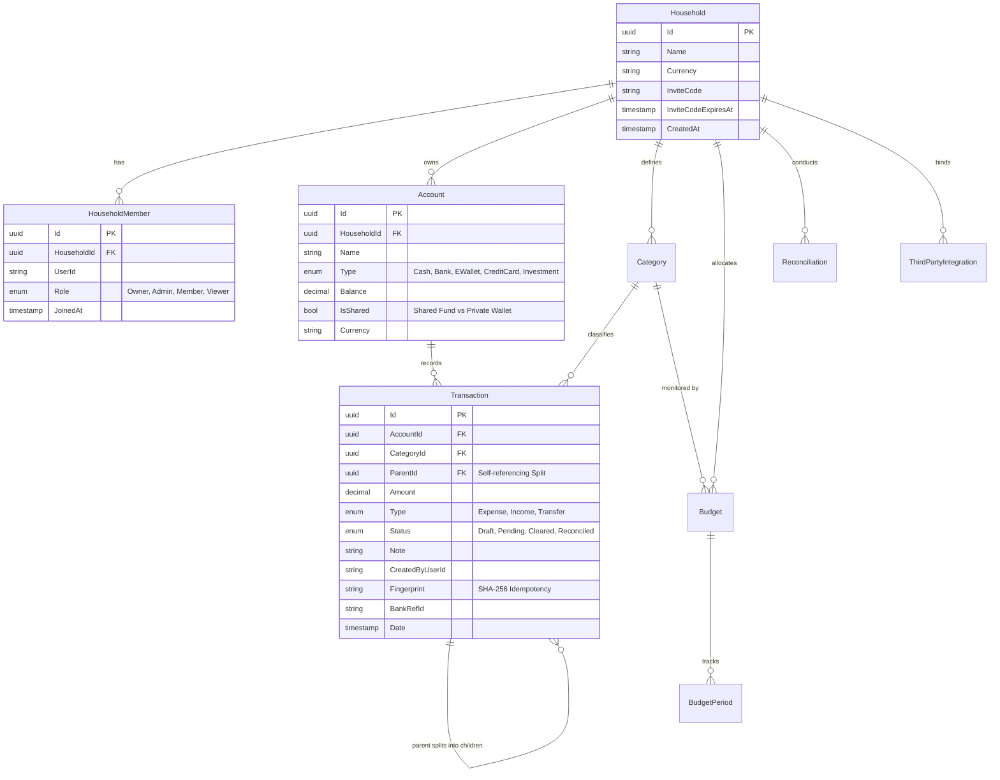
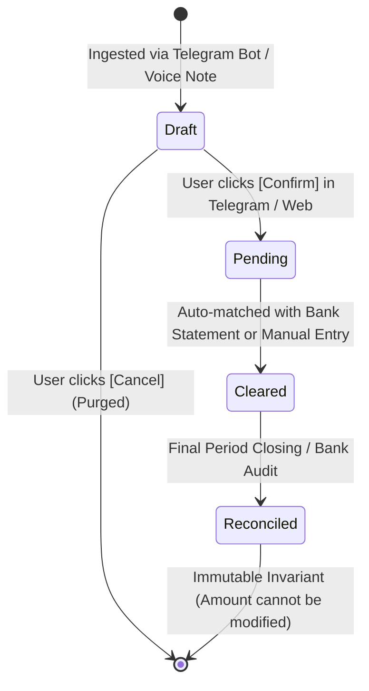

# 🏛️ DCExpense - System Architecture & Technical Blueprint

## 1. Overview & Core Philosophy
**DCExpense** is a Next-Generation Personal & Household Financial Management System (PFM 2.0) built on Microsoft .NET 8, PostgreSQL 16 (EF Core 8), and a modern Progressive Web App (PWA) client.

### Core Architectural Principles
1. **Clean Architecture / Domain-Driven Design (DDD)**: Business logic and financial invariants are completely isolated in `DCExpense.Domain` and `DCExpense.Application`.
2. **Zero-Friction Ingestion**: Ingest transactions effortlessly via Telegram Natural Language NLP (Voice Notes & Quick Text), Excel/CSV statement imports, and Web SPA quick-entry.
3. **Smart Reconciliation Engine**: Automated sliding-window matching ($\pm 7$ days), human error transposition detection (Modulo 9), and SHA-256 fingerprint deduplication.
4. **Household Multi-Tenancy**: Shared Wallets (`IsShared = true`) co-existing with Private Wallets (`IsShared = false`), protected by a 4-tier Role-Based Access Control (RBAC) model.
5. **Unified Identity & Access**: Single Sign-On (SSO) integration with DCManager Identity Provider (OAuth 2.1 / OIDC / PKCE / JWT).

---

## 2. Solution Structure

```
D:\Agy\DCExpense/
├── DCExpense.Domain/                  # Core Business Domain (No external dependencies)
│   ├── Entities/                      # 9 Invariant Entities (Household, Account, Transaction, Split...)
│   └── Enums/                         # AccountType, TransactionStatus, BudgetType, HouseholdRole...
│
├── DCExpense.Application/             # Application Business Logic & Contracts
│   ├── DTOs/                          # Phase DTOs, TelegramDTOs, DashboardDTOs, AuthDTOs
│   ├── Interfaces/                    # Service Contracts (ITransactionService, IReconciliationService...)
│   └── Services/                      # Application Implementations:
│       ├── AiVoiceExpenseParser.cs    # Vietnamese Vernacular Tokenizer & Currency NLP
│       ├── DashboardService.cs        # Net Worth & Safe-to-Spend Computation
│       ├── HouseholdService.cs        # CSPRNG Invite Codes, Multi-tenancy & RBAC
│       ├── ReconciliationService.cs   # Sliding-Window & Modulo 9 Math Matcher
│       └── TransactionStateMachine.cs # Deterministic Finite State Machine
│
├── DCExpense.Infrastructure/          # Data Access & External Integrations
│   ├── Data/
│   │   └── DCExpenseSeedData.cs       # Rich PostgreSQL Seed Data (Accounts, Budgets, Tx)
│   ├── Services/
│   │   ├── BankStatementParser.cs     # CSV / Excel Bank Statement Ingestion
│   │   └── TelegramBotService.cs      # Telegram Webhook, Voice STT, 2-Way Inline Keyboards
│   └── Infrastructure.cs              # EF Core DbContext & SHA-256 Fingerprint Generator
│
├── DCExpense.WebApi/                  # Host, Web API & Progressive Web App (PWA)
│   ├── Controllers/                   # RESTful API Endpoints (Auth, Dashboard, Accounts, Tx, Reconciliation...)
│   ├── wwwroot/                       # Web SPA Frontend & PWA Assets:
│   │   ├── index.html                 # Glassmorphism Financial Dashboard & Staging UI
│   │   ├── app.js                     # ES6 Client Logic, PWA Prompt, Chart.js Data Binding
│   │   ├── manifest.json              # Web App Manifest (Standalone PWA)
│   │   ├── sw.js                      # Cache-First / Network-First Service Worker
│   │   └── statement_vcb_sample.csv   # Bank Statement Reconciliation Sample
│   ├── Program.cs                     # Middleware Pipeline, DI, JWT Auth & SPA Fallback
│   └── appsettings.json               # Database, JWT, and Telegram Bot Configuration
│
├── DCExpense.Tests/                   # Automated Unit & Integration Tests (84 Tests - 100% Pass)
│   ├── Phase1Tests.cs                 # Domain Invariants & Entity Integrity
│   ├── Phase2Tests.cs                 # Reconciliation Math & Transaction State Machine
│   ├── FrontendAndPwaTests.cs         # Static Assets & PWA WebAppManifest Validation
│   ├── Phase4Tests.cs                 # AI NLP, Vietnamese Slang & Multi-Tenancy RBAC
│   └── Phase5IntegrationTests.cs     # Seed Data, Real DB Endpoints & Live Calculations
│
└── tests-e2e/                         # Playwright Browser E2E Test Suite (5 Tests - 100% Pass)
    ├── dcexpense.spec.js              # Full-journey Browser Automation Tests
    ├── playwright.config.js           # Playwright Engine Configuration
    └── screenshots/                   # Automated Photographic Test Evidence
```

---

## 3. Database Entity Relationship Diagram (PostgreSQL 16)



---

## 4. Transaction Deterministic State Machine



- **Draft**: Temporary state from conversational / voice note inputs. Does not impact account balance.
- **Pending**: Confirmed by user. Affects live cash flow balance.
- **Cleared**: Verified against bank statement clearance.
- **Reconciled**: Permanently locked. Invariants enforce that `Amount` and `AccountId` can never be edited.
